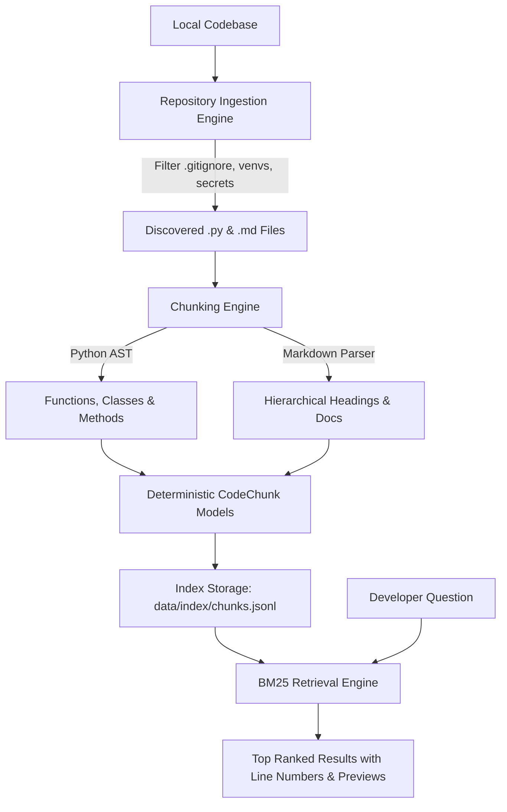

# GitContext 🔍

> **AI-Powered Codebase Intelligence Copilot — Phase 1 (Local Code/Doc Chunking & BM25 Search)**

GitContext helps developers quickly understand unfamiliar repositories by indexing local source code and documentation, and finding the exact files, functions, classes, and line numbers relevant to developer questions.

---

## 🎯 The Problem GitContext Solves

When exploring a new codebase or onboarding to a large repository, developers spend hours asking:
* *"Where is authentication or token validation handled?"*
* *"Which function processes Stripe payments and charges customers?"*
* *"Where is the database connection pool configured?"*

Traditional search (like `grep` or standard IDE text search) either misses context or returns hundreds of raw text hits without structural meaning. GitContext parses your code into **semantic AST chunks** (functions, classes, methods) and **hierarchical documentation sections**, allowing keyword and natural-language retrieval powered by **BM25 ranking**.

---

## 🏗️ Phase 1 Architecture

Phase 1 establishes a rock-solid, local, deterministic foundation without depending on external LLMs or cloud embeddings.



### Module Breakdown

| Module | Location | Purpose |
|---|---|---|
| **Models** | [`src/gitcontext/models.py`](file:///c:/Users/Aditya%20Raj/OneDrive/Documents/Desktop/Git%20Context/src/gitcontext/models.py) | Defines `CodeChunk`, `SearchResult`, and `IndexMetadata` dataclasses with SHA-256 deterministic IDs. |
| **Ingestion** | [`src/gitcontext/ingestion.py`](file:///c:/Users/Aditya%20Raj/OneDrive/Documents/Desktop/Git%20Context/src/gitcontext/ingestion.py) | Safely scans local directory trees, filters ignored/sensitive files (`.gitignore`, `.env`, `node_modules`, `venv`), and reads UTF-8 files safely. |
| **Chunking** | [`src/gitcontext/chunking.py`](file:///c:/Users/Aditya%20Raj/OneDrive/Documents/Desktop/Git%20Context/src/gitcontext/chunking.py) | Uses Python AST (`ast.parse`) to extract functions and classes with 1-based line bounds; splits Markdown by heading hierarchy. |
| **Indexing** | [`src/gitcontext/indexing.py`](file:///c:/Users/Aditya%20Raj/OneDrive/Documents/Desktop/Git%20Context/src/gitcontext/indexing.py) | Serializes and loads chunks to/from `data/index/chunks.jsonl` and metadata to `metadata.json`. |
| **Retrieval** | [`src/gitcontext/retrieval.py`](file:///c:/Users/Aditya%20Raj/OneDrive/Documents/Desktop/Git%20Context/src/gitcontext/retrieval.py) | BM25 Okapi retriever with code-aware tokenization (splits `camelCase`, `snake_case`, and punctuation). |
| **CLI** | [`src/gitcontext/cli.py`](file:///c:/Users/Aditya%20Raj/OneDrive/Documents/Desktop/Git%20Context/src/gitcontext/cli.py) | User-friendly command-line interface supporting `index`, `search`, and `status` commands. |

---

## 🚀 Getting Started

### Prerequisites
* Python 3.11 or newer (Python 3.13 supported)

### 1. Installation

Clone or navigate to the repository directory and install dependencies:

#### Windows PowerShell:
```powershell
# Navigate to project folder
cd "c:\Users\Aditya Raj\OneDrive\Documents\Desktop\Git Context"

# Install package in editable mode with development dependencies
python -m pip install -e ".[dev]"
```

#### macOS / Linux:
```bash
python3 -m pip install -e ".[dev]"
```

---

## 💻 Usage & CLI Commands

### 1. Index a Repository
Point GitContext at any local codebase directory:

```bash
python -m gitcontext index fixtures/synthetic_repo
```

**Expected Output:**
```text
Indexing repository: C:\Users\...\Git Context\fixtures\synthetic_repo

--- Indexing Completed Successfully ---
Repository : synthetic_repo (C:\Users\...\Git Context\fixtures\synthetic_repo)
Files      : 3 file(s) ingested
Chunks     : 17 chunk(s) stored
Saved to   : C:\Users\...\Git Context\data\index\chunks.jsonl
Indexed at : 2026-10-09 17:46:44 UTC
```

---

### 2. Search the Codebase
Ask natural language questions or search for symbols:

```bash
python -m gitcontext search "how to hash and verify password"
```

**Expected Output:**
```text
Query: "how to hash and verify password"
Searching in: synthetic_repo (17 chunks)
======================================================================

Result #1 (Score: 10.02) [CODE]
  File     : auth.py
  Symbol   : def verify_user_credentials
  Lines    : L16 - L19 (python)
  Chunk ID : 2de8d4144f1580b5
  Preview  :
    def verify_user_credentials(provided_password: str, stored_hash: str, salt: str) -> bool:
        """Validate user credentials against stored salt and hash."""
        computed_hash, _ = hash_user_password(provided_password, salt=salt)
        return secrets.compare_digest(computed_hash, stored_hash)
----------------------------------------------------------------------

Result #2 (Score: 6.04) [CODE]
  File     : auth.py
  Symbol   : def hash_user_password
  Lines    : L8 - L13 (python)
  Chunk ID : 3dd46016a7e14510
  Preview  :
    def hash_user_password(password: str, salt: Optional[str] = None) -> tuple[str, str]:
        """Generate a cryptographic SHA-256 password hash with salt."""
        if salt is None:
            salt = secrets.token_hex(16)
        hashed = hashlib.sha256(f"{salt}:{password}".encode("utf-8")).hexdigest()
        return hashed, salt
----------------------------------------------------------------------
```

---

### 3. Check Current Index Status
View details of the currently loaded repository:

```bash
python -m gitcontext status
```

**Expected Output:**
```text
=== GitContext Index Status ===
Repository     : synthetic_repo
Source Path    : C:\Users\...\Git Context\fixtures\synthetic_repo
Files Ingested : 3
Chunks Stored  : 17
Index Path     : C:\Users\...\Git Context\data\index\chunks.jsonl
Last Indexed   : 2026-10-09 17:46:44 UTC
```

---

### 4. Ask Grounded Questions with Verified Citations (Step 3)
Query the codebase using an LLM that answers exclusively with cited file paths and line ranges:

```bash
python -m gitcontext ask "Where is token expiry checked?"
```

**Expected Output:**
```text
Question: Where is token expiry checked?

Answer:
**Facts:**
- Session token expiry is initialized in `UserSessionManager.__init__` with a default `token_expiry_seconds=3600` [1].
**Inferences:**
- None.

Sources:
  [1] auth.py:L22-L38 (class UserSessionManager)
```

Configure your LLM provider and model via environment variables in `.env`:
```bash
cp .env.example .env
# Set LLM_PROVIDER=openai, gemini, anthropic, or ollama
# Set your API key
```

---

## 🧪 Running Automated Tests

Run the full test suite with `pytest`:

```bash
pytest -v
```

All 31 unit and integration tests cover:
- Python function and class AST extraction with line numbers
- Markdown hierarchical heading section chunking
- Deterministic chunk hashing & ID generation
- `.gitignore` and sensitive file exclusions (`.env`, `credentials.json`)
- Syntax error resilience
- BM25 ranking and camelCase / snake_case tokenization
- Hybrid retrieval with Reciprocal Rank Fusion
- LLM generation with prompt injection defenses and strict grounding
- Citation verification, invalid citation stripping, and line-range validation
- Error handling: missing API keys, empty retrieval, and LLM provider failures
- Grounded citation evaluation suite benchmarking precision and recall
- CLI subcommands (`index`, `search`, `status`, `ask`)

---

## 🔮 Roadmap & Next Milestones

* ✅ **Phase 1 — AST Chunking & BM25 Search**: Structural code parsing and keyword retrieval.
* ✅ **Phase 2 — Hybrid Retrieval**: Reciprocal Rank Fusion combining lexical and dense search.
* ✅ **Step 3 — LLM-Powered Citation Assistant**: Grounded answer synthesis, citation validation, and CLI `ask`.
* **Phase 4 — Live Synchronization**: Automatically keep index up to date as commits are pushed.
* **Phase 5 — FastAPI Backend & Web UI**: REST API and interactive interface with code highlighting.

